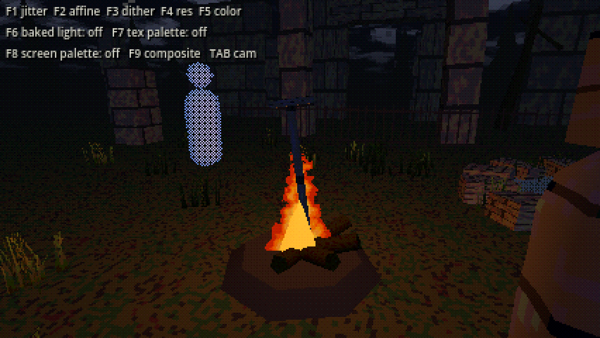
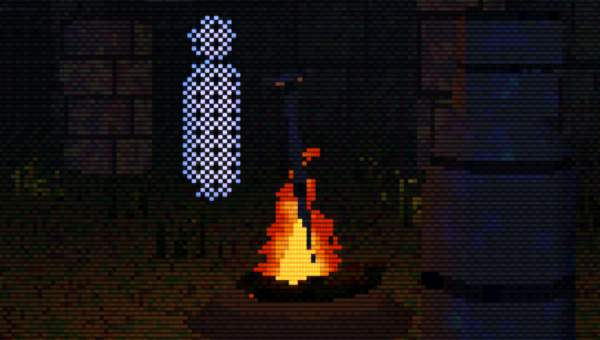
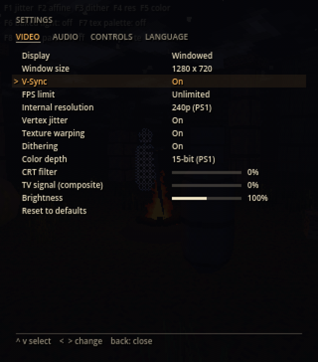
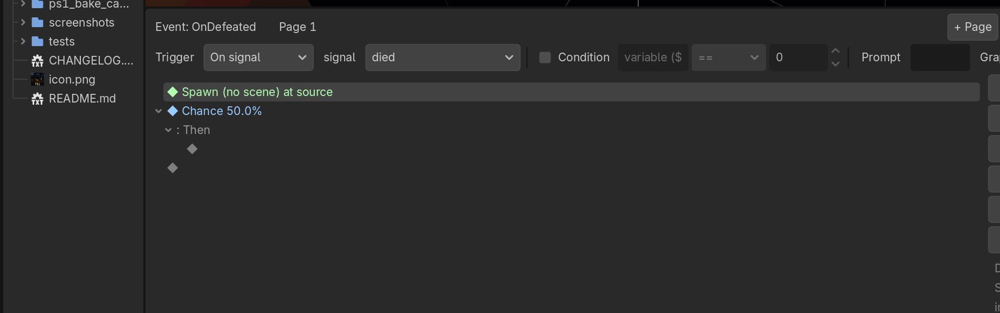
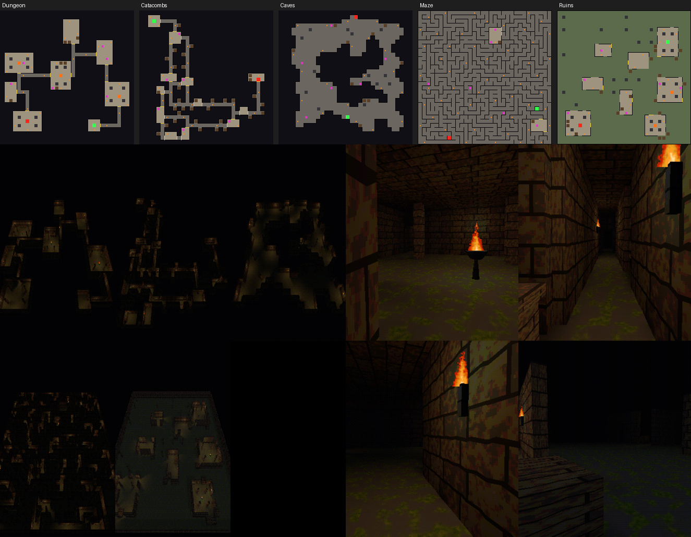
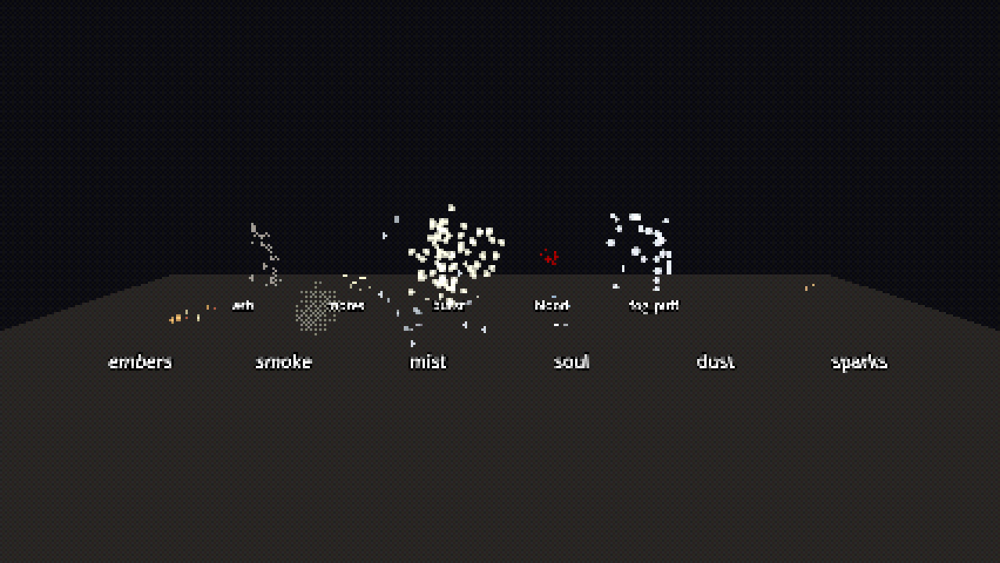
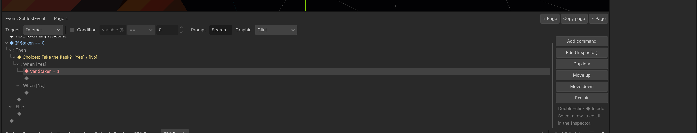
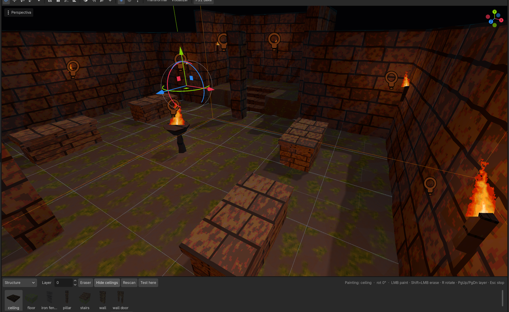
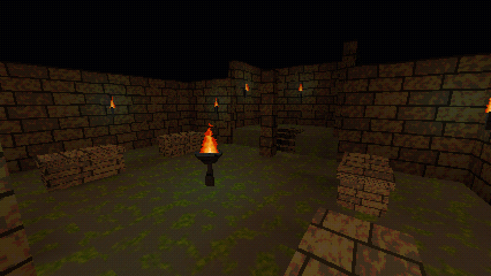

# PS1 Maker

A small, drop-in toolkit for making **PlayStation 1-style 3D games in Godot 4** (Godot 4.5 or newer; tested on 4.5, 4.6 and 4.7).

It reproduces the hardware quirks that make PS1 games look the way they do, without getting in the way of modern gameplay code:

| Effect | How |
|---|---|
| Vertex jitter (wobbly geometry) | Vertices snapped to a low-res screen grid in clip space |
| Affine texture mapping (warping textures) | Perspective correction undone in the shader |
| Per-vertex (Gouraud) lighting | `vertex_lighting` render mode |
| Crunchy textures | Nearest filtering, no mipmaps |
| Low resolution | 320x240 base viewport, integer-ish nearest upscale (widens on 16:9) |
| 15-bit color + dithering | Full-screen post-process with a 4x4 Bayer matrix |
| Fog / short draw distance | `Environment` depth fog + `PS1.draw_distance()` / `PS1LOD` with dithered fades |
| Screen-door transparency | `dither_alpha` material (no alpha blending, like the PS1) |
| Alpha-tested textures | `cutout` material (fences, grass, foliage) |
| 4/8-bit CLUT textures | `PS1Palette.quantize(tex, 16)` (k-means palette) |
| Pre-lit geometry (Silent Hill / RE style) | `PS1Bake`: lights + raycast shadows baked into vertex colors, cached to disk |
| Fixed screen palette | `PS1.set_screen_palette()` / `PS1.palette_from_screen(24)` |
| Particles: PS1-looking CPU particles + 11 presets | `PS1Particles` |
| Audio: SPU-ish buses, pitch-varied one-shots, music crossfade | `PS1Audio` |
| Events (RPG Maker style): pages, triggers, text/choices, variables, custom commands | `PS1Event` + "PS1 Events" panel |
| Level painter (RPG Maker style) | `PS1GridLevel` + "PS1 Pieces" panel: paint pieces on a grid in the 3D viewport, auto-edge walls, layers, undo, "Test here"; starter piece kit included |
| Sprites (trees, fire, particles) | `PS1Sprite`: billboards with jitter, alpha test and sprite-sheet animation |
| Composite video (TV) look | `PS1.set_composite(1.0)`: chroma bleed, line jitter, grain, vignette |
| CRT at native resolution | `PS1.set_crt(1.0)`: scanlines, aperture grille, curvature |
| On-defeated events, drops, loading screen | `PS1Event` "On signal" pages (+ Event button), `PS1CmdSpawn`, `PS1CmdChance`, `PS1Loader` |
| Procedural levels | `PS1LevelGen`: dungeons, catacombs, caves, mazes, ruins, built from grid pieces (editor button or code) |
| Vertex paint (fake AO, gradients, grime) | `PS1VertexPaint`, or *Vertex paint* options on `PS1BakedLevel` |
| Mist, shockwaves, footwork | `PS1Mist` (soft fog walls/banks), `PS1Shockwave` (dust ring that is also a hit area), `PS1Anim.graft()` (real legs under upper-body animations) |
| Sky dome and water | `PS1Sky` (gradient into fog, clouds, stars, moon), `PS1Water` (waves, scrolling affine layers, dithered transparency) |


## Install

1. In the editor's **AssetLib** tab search for **PS1 Maker** and install it, or copy `addons/ps1_godot/` into your project.
2. *Project > Project Settings > Plugins*: enable **PS1 Maker**. This registers the `PS1` autoload and the `ps1_*` shader globals.
3. Restart the editor (shader globals are only picked up on startup).
4. Recommended project settings (see this repo's `project.godot`):
   - `display/window/size/viewport_width/height = 320 x 240`, `stretch/mode = viewport`, `stretch/aspect = expand`
   - `rendering/textures/canvas_textures/default_texture_filter = Nearest`
   - `rendering/anti_aliasing/quality/msaa_3d = Disabled`

## Usage

**Materials from code**
```gdscript
var mat := PS1.material(my_texture, Color.WHITE, Vector2(4, 4))   # texture, tint, uv scale
var glow := PS1.material(tex, Color.WHITE, Vector2.ONE, Color.ORANGE, 2.0)  # + emission
var cape := PS1.material(tex, Color.WHITE, Vector2.ONE, Color.BLACK, 0.0, true)  # double-sided
```

**All options** (`PS1.make`)
```gdscript
var fence := PS1.make(fence_tex, {mode = "cutout", alpha_cut = 0.5})
var ghost := PS1.make(tex, {mode = "dither_alpha", color = Color(1, 1, 1, 0.4)})
var crunchy := PS1.make(tex, {texture_color_levels = 8})   # per-channel levels, cheap
```
Modes: `opaque` (default), `double_sided`, `cutout`, `dither_alpha`, `unlit`, `unlit_cutout`.
Other keys: `color`, `uv_scale`, `emission`, `emission_energy`, `alpha_cut`, `texture_color_levels`, `vertex_color`.

**Texture palettes** (like PS1 4-bit / 8-bit CLUT textures)
```gdscript
var tex16 := PS1Palette.quantize(my_texture, 16)          # k-means, once at load
var tex16d := PS1Palette.quantize(my_texture, 16, 0.5)    # + ordered dithering
```
Or in the editor: select textures in the FileSystem dock, open `addons/ps1_godot/tools/quantize_selected.gd`
and run it (*File > Run*). It writes `<name>_16c.png` next to each texture.


**Draw distance and LOD**
```gdscript
PS1.draw_distance($Trees, 20.0, 4.0)   # dithered fade between 16 and 20 m, then culled
```
`PS1LOD` node: its children are the levels (child 0 up close). `distances = [15]` switches to child 1
at 15 m, `draw_distance = 27` hides the last level, `fade = 3` makes every switch a dithered
cross-fade (`0` = hard pop, very PS1). In and out fades use complementary dither patterns, so the
two levels never leave holes or overlap.


**Baked vertex lighting** (pre-lit geometry, the Silent Hill / Resident Evil way)
```gdscript
await PS1Bake.bake_scene($Level, Color(0.2, 0.2, 0.25))   # ambient; shadows on by default
```
Bakes every visible light (directional, omni, spot) plus raycast shadows into vertex colors and
switches the materials to the `unlit` variant (`texture * vertex color * 2`, the PS1's 2x
modulation). Static levels get lighting and shadows for free at runtime; keep characters and
moving props on lit materials. Lighting is per vertex, so subdivide big surfaces.
`mesh.set_meta("ps1_no_bake", true)` skips a mesh, `"ps1_no_cast"` bakes it without casting
shadows (small props sitting on a light), `light.set_meta("ps1_no_shadow", true)` disables a
light's shadows. Cutout meshes (grass, fences) never cast baked shadows.

**One-click bake (recommended workflow)**
1. Put the static geometry of your level under a **`PS1BakedLevel`** node (set its `ambient`).
2. Click **PS1 Bake** in the 3D editor toolbar. The scene is saved and baked in a background
   headless process (physics is needed for the shadow rays), and the result goes to
   `res://ps1_bake_cache/`.
3. At runtime the node loads the cache instantly; if the level changed since the bake, it rebakes
   on load and saves again (when running from the editor).

Same thing from a terminal / CI: `godot --headless --path . res://my_level.tscn -- --ps1-bake-only --ps1-bake-force`

**Bake once, load instantly (from code)**
```gdscript
await PS1Bake.bake_scene_cached($Level, Color(0.2, 0.2, 0.25))   # -> res://ps1_bake_cache/<scene>_<node>.res
```
The first run bakes and saves; later runs load the result (demo: ~400 ms -> ~80 ms). The cache is
rebuilt automatically when meshes, transforms or lights change. Run the scene once from the editor
and ship the cache file with your game (`res://` is read-only in exported builds).


*Left: realtime vertex lighting. Right: baked (light + shadows in vertex colors, unlit materials).*

**Sprites** (`PS1Sprite`: pivot at the bottom center)
```gdscript
var pine := PS1Sprite.new()              # lit, turns around Y only: trees, sprite characters
pine.texture = PS1Textures.pine()
pine.size = Vector2(3, 6)

var fire := PS1Sprite.new()              # unlit, always faces the camera: fire, effects
fire.texture = PS1Textures.flame_sheet() # 4 frames side by side
fire.hframes = 4
fire.fps = 10.0
fire.lit = false
```
Materials `billboard` / `billboard_unlit` also work on any quad, including `GPUParticles3D`
draw passes. Frame selection is a per-instance uniform (`ps1_uv_rect`), so many sprites share
one material.



**Composite video filter**
```gdscript
PS1.set_composite(1.0)   # 0 = off. Chroma bleeds over ~3 pixels, luma stays sharp, rare line
                         # jitter, grain and vignette. Applied after dithering, so it "melts"
                         # the dither pattern like a real TV did.
```

*Left: clean output. Right: composite filter.*

**Screen palette** (the whole frame limited to N colors, max 256)
```gdscript
PS1.set_screen_palette(PackedColorArray([Color("#0b0c10"), Color("#3a2f2a"), ...]))
await PS1.palette_from_screen(24)   # k-means palette of the current frame, applied at once
PS1.clear_screen_palette()
```
`palette_from_screen` counts each distinct color once, so small but important areas (a fire, a
moon) keep their colors. Uses the global dithering setting.


**Sky and water**
```gdscript
var sky := PS1Sky.new()                  # follows the camera; horizon = fog color by default
sky.clouds = PS1Sky.cloud_texture()
sky.moon_direction = $Moon.global_basis.z
add_child(sky)

var pond := PS1Water.new()               # subdivided plane with vertex waves
pond.size = Vector2(6, 4)
pond.color = Color(0.35, 0.5, 0.62, 0.7) # alpha = screen-door density
add_child(pond)
```

**Shader globals at runtime**: use `PS1.set_global(name, value)` / `PS1.get_global(name)`.
(`RenderingServer.global_shader_parameter_get()` only works inside the editor.)

**Hit flash** (per-instance, no material duplication)
```gdscript
PS1.flash($Enemy)                         # white flash, 0.12 s
PS1.flash($Player, Color.RED, 0.2)
```

**Convert imported models (Blender .glb, .blend...)**
```gdscript
PS1Convert.apply($Knight)   # keeps albedo color/texture, emission and cull mode
```
Or do it at import time: select the model, in the *Import* dock set **Import Script** to
`res://addons/ps1_godot/import/ps1_post_import.gd` and click *Reimport*.

**Shaders** (use directly on a `ShaderMaterial`):
- `shaders/ps1_lit.gdshader` / `ps1_lit_double_sided.gdshader` - parameters `albedo_tex`, `albedo_color`, `uv_scale`, `emission_color`, `emission_energy`
- `shaders/ps1_post.gdshader` - applied automatically by the `PS1` autoload

**Global settings** (*Project Settings > Shader Globals*, or at runtime with `RenderingServer.global_shader_parameter_set`):

| Global | Default | Meaning |
|---|---|---|
| `ps1_snap_resolution` | `(320, 240)` | Grid vertices snap to. Lower = more wobble |
| `ps1_jitter_enabled` | `1.0` | Vertex snapping on/off |
| `ps1_affine_enabled` | `1.0` | Affine texture warping on/off |
| `ps1_dither_enabled` | `1.0` | Dithering on/off |
| `ps1_color_levels` | `32.0` | Levels per color channel (32 = 15-bit color) |

**Debug keys** (debug builds only; set `PS1.debug_keys = false` to disable):
F1 jitter, F2 affine, F3 dither, F4 resolution (240p/360p/480p), F5 color depth, F9 composite, F10 CRT.

### CRT

`PS1.set_crt(1.0)` (or F10) adds a CRT at your monitor's **native** resolution: scanlines whose
width follows brightness, an RGB aperture grille and tube curvature. While it's on, the window
renders at native resolution and the post-process samples it on the low-res grid, so the PS1
picture itself is unchanged (it does cost more GPU). Combine with `set_composite()` for the full
"console on a TV" look; tweak with `PS1.crt_params(curvature, scanlines, mask, brightness)`.

Text stays readable: while the CRT is on, CanvasLayers with `layer >= PS1.crt_ui_layer` (2) —
HUD, dialog boxes, menus — draw over the tube, sharp. Put world-space 2D that should be filtered
on layer 0–1, or set `PS1.crt_covers_ui = true` to filter everything.



## Settings, pause menu & translations



```gdscript
PS1Locale.setup("res://lang/strings.csv")            # en + every translated column
PS1Settings.add_binding(&"attack", "Attack")         # rebindable (keyboard + gamepad)
PS1Settings.add_option({key = "game/shake", section = "video", label = "Screen shake",
	type = "bool", default = true, apply = func(v): shake_enabled = v})
PS1Settings.setup()                                  # loads user://ps1_settings.cfg and applies it

PS1SettingsMenu.open()                               # title screen "Settings"
PS1PauseMenu.open_action = &"pause"                  # Esc / Start in game
PS1PauseMenu.entries = [["Resume", PS1PauseMenu.RESUME], ["Settings", PS1PauseMenu.SETTINGS],
	["Save", func(m): save(); m.toast("Saved")], ["Quit", PS1PauseMenu.QUIT]]
```

- Option types: `bool`, `range` (`min`, `max`, `step`, `suffix`), `choice` (`choices` = `[[value, label], ...]`).
  Values: `PS1Settings.get_value(key)`; changes: `PS1Settings.signals().changed`.
- Camera code reads `PS1Settings.mouse_sensitivity()`, `stick_sensitivity()`, `invert_y()`.
- Translations: write texts in your own language; *Project > Tools > PS1: Update translation CSV*
  collects event texts, choices, prompts and every `tr("...")` / `PS1Locale.mark("...")`, keeping
  what's already translated. Fill the columns, done — events translate themselves, `{variables}` included.
- Demo: `demo/settings_demo.tscn` (Esc).

## Gothic architecture & panoramas

**PS1Gothic** builds low-poly medieval/gothic architecture in code: curtain walls with
battlements, polygonal towers, spires, gable roofs, pointed (ogival) doorways and arch moldings,
lancet and rose windows with stone tracery, buttresses, columns (whole or broken), steps, ruined
towers, braziers, plus graveyard props (tombstones, crosses, swords stuck in the ground, dead
trees). Faces are subdivided for vertex lighting and UVs are world-space boxes (`uv_meters`), so
textures line up across pieces. Shapes go into named surfaces, each with its own material.

```gdscript
var g := PS1Gothic.new()
g.wall(Vector3(0, 0, -15), 20.0, 8.0, 1.2)         # wall with merlons
g.portal(Vector3(0, 0, -15), 5.0, 8.0, 4.0, 1.8)    # pointed doorway through it (walkable)
g.tower(Vector3(10, 0, -15), 2.8, 14.0)
g.surface("roof").spire(Vector3(10, 14.8, -15), 3.4, 10.0)
g.surface("glow").rose(Vector3(0, 6, -14.3), 1.2)
g.surface("stone").rose_tracery(Vector3(0, 6, -14.3), 1.2)
level.add_child(g.build({stone = stone_mat, roof = roof_mat, glow = glow_mat}))   # + collision
```

New textures for it: `PS1Textures.ashlar()`, `flagstones()`, `slate_roof()`, `banner()`.

**PS1Backdrop** is the "new area, look at that view" layer: far silhouettes (a castle on the
mountain, a cathedral across the valley, mountain ridges) drawn past the camera's far plane, in
front of the sky. Each layer fades into the haze by distance, its feet sink into a moonlit sea of
mist, and surfaces named `glow` become lit windows. No lights, no fog, never culled.

```gdscript
var bd := PS1Backdrop.new()
bd.haze_color = fog_color
bd.mist_height = -9.0
add_child(bd)
bd.add_mist_sea()
bd.add_mesh(PS1Backdrop.ridge(3, 1100.0, 150.0), Transform3D(Basis(), Vector3(0, -30, -520)), 0.45)
bd.add_mesh(castle.mesh(), Transform3D(Basis(), Vector3(0, 8, -125)), 0.15)   # a PS1Gothic mesh
```

Demo: `demo/gothic_demo.tscn`.

## Creatures, cave-ins and sewers

**PS1Creature** builds low-poly creatures from a body plan (body segments, leg pairs, head,
tail, several bodies in a ring) and bakes their animations into a normal AnimationPlayer:
`idle`, `walk`, `run`, `attack` (lunge/bite), `slam` (rear up and smash), `spin`, `hit`, `die`.
Any enemy AI that plays animations just works. Presets: `rat()`, `crawler()` (pale segmented
body on human arms, wearing a face), `rat_king(n)` (n rats knotted by the tails), `gargoyle()`.

```gdscript
var rat := PS1Creature.rat()
add_child(rat)
rat.animation_player().play("walk")
var bite_hitbox_origin := rat.heads()[0]   # nodes named "Head" / "Jaw"
```

**PS1Collapse** (and the event command *Scene/Collapse*): rocks rain from the ceiling over an
area, land with dust and stay as rubble, while every node in group `ps1_shake` gets
`ps1_shake(strength)`. `await PS1Collapse.spawn(self, pos, 8.0, 3.0).finished`.

**PS1Gothic** also builds sewers and rooms: `sewer()` (channel between walkways, barrel vault,
stone bridges, invisible railings so nobody falls in), `room()` (walls with door gaps and
lintels), `dais()` (a platform with steps all round), `valve_wheel()`, `rock()`, `spindle()`/`limb()` for organic shapes, and `quad_away()`/`quad_toward()`
to get the winding right without thinking about it.

## Gargoyles, archers and puzzles

**PS1Creature** got wings and horns (`wing_span`, `horns`) and three more animations: `perch`
(a statue's pose), `wake` (breaking free of it) and `pounce` (a long leap with the wings open).
Preset: `gargoyle()`.

**PS1Biped** is the same idea for humanoids: rigid low-poly parts on a node rig, animations
baked from keyed poses (a pose says "point the forearm *that way*", in model space, so you
don't fight Euler angles). Preset `archer()`: hood, cloak, quiver and a longbow whose string is
pulled to the cheek; `shoot` emits `released` at the release frame. Animations: `idle`, `walk`,
`walk_back`, `run`, `shoot`, `bash`, `hit`, `die`, `spew`, `claw`, `hang`, `drop`; add your own
with `add_animation()`.

### Sewer grotesques (1.6)

| Preset | What it is | Animations worth knowing |
|---|---|---|
| `PS1Creature.leech()` | legless segmented body, `head_style = "maw"` (round toothed mouth) | `attack` (lunge), `slam` |
| `PS1Biped.drowned()` | bald, bloated, `belly = 1.0` | `spew` (rear back, heave, hold), `claw` |
| `PS1Biped.hanged()` | gaunt, `arm_length = 1.45`, long fingers, sack hood | `hang` (loop), `drop`, `claw` |

`PS1Particles.preset("bile")` is the vomit jet that goes with `spew`; `"splash"` is for anything
breaking a water surface. `PS1Water.glow_color` tints the fake reflection (green for sewers).

**PS1Projectile**: arrows and bolts that fly with gravity, point along the flight and stick in
walls. `PS1Projectile.aim()` solves the arc to reach a target. Damage stays in your game: put
your hitbox on it and call `stop()` when it hits someone.

```gdscript
var a := PS1Projectile.arrow()
get_tree().current_scene.add_child(a)
a.launch(hand.global_position, player.global_position + Vector3(0, 1.1, 0), 28.0)
```

**PS1Sequence** is an ordered-sequence puzzle (bells, levers, braziers): `step("id")` answers
CORRECT / SOLVED / WRONG / DONE, keeps the progress in an event variable (saved with the game)
and sets `solved_variable` when done, so doors can open on it. From events: *Puzzle/Sequence
Step*, with one command list per answer. *Scene/Animate Node* swings a bell, shakes, turns a
statue or slides a wall (`PS1CmdAnimate.animate()` from code).

**PS1Gothic** new pieces: `rampart()` (wall walk on top of a curtain wall, parapets that keep
you from falling, merlons on the outer side, gaps for stairs and balconies), `belfry()`,
`bell()` and `lathe()` (any surface of revolution).

## Navigation, inventory and combat effects

**Navigation for code-built levels.** Levels made with PS1Gothic / the level painter don't ship a
navmesh, so `PS1Navigation` bakes one at runtime from the static colliders and steers bodies
around walls (straight line when the way is clear, navmesh path when it isn't, with a stuck
detector that falls back to the path):

```gdscript
PS1Navigation.bake(level_root)                     # once, after building the level
var dir := PS1Navigation.steer(self, player.global_position)   # every frame, in an enemy
PS1Navigation.can_see(self, eyes, target, 1)       # line of sight against the level
```

Tune the static `agent_radius` (default 0.25 so 1.2 m arches stay open), `agent_height`,
`max_climb`, `max_slope` and `cell` before baking; `PS1Navigation.enabled = false` turns it off
for A/B tests. `rebake(region)` refreshes it after doors open or walls fall.

**Inventory and equipment.** `PS1Item` (a Resource: id, name, description, kind, slot, icon,
stackable, `stats` dictionary, optional model) and `PS1Inventory` (counts + equipped slots,
`changed` / `equipped` / `unequipped` signals, `to_dict()` / `from_dict()` for saves).
`PS1InventoryMenu` browses it in the same style as the other menus — push it as a pause-menu
page or open it on its own layer:

```gdscript
var inv := PS1Inventory.new()
inv.register(PS1Item.make("short_sword", "Short Sword", PS1Item.Kind.WEAPON, {stats = {damage = 1.0}}))
inv.register(PS1Item.make("oak_shield", "Oak Shield", PS1Item.Kind.SHIELD, {stats = {block_cost = 0.6}}))
inv.add("short_sword"); inv.equip("short_sword")
var mult: float = inv.stat("weapon", "damage", 1.0)
pause_menu.push(PS1InventoryMenu.create(inv))
```

**Combat effects.** `PS1FX.sweep()` draws a glowing arc on the ground that runs around a point
(sword sweeps, a 360° spin attack, area telegraphs); `PS1FX.aura(mesh)` adds a `PS1Aura` shell
around a mesh — set `level` 0..1 for a charging weapon (glow → sparks → light on the
surroundings with `light_energy`). Both are additive, 5-bit and dithered like the rest.
`PS1Gothic.heater_shield()` builds a small heater shield (surfaces `wood`, `rim`, `boss`).

## Mist, shockwaves and footwork

```gdscript
var fog := PS1Mist.new()                 # fog wall / fog bank
fog.size = Vector3(4, 4, 0.7)            # width, height, depth of the layers
add_child(fog)

# boss slam: a dust ring rolls out and hurts whoever is on the ground when it passes
var w := PS1Shockwave.spawn(get_tree().current_scene, impact_pos, 8.0, 0.85, "player")
w.reached.connect(func(b): if b.is_on_floor(): b.take_hit(25))

# a hand-made slash that only animates the torso: graft a real step under it
var legs := PS1Anim.lower_body(skeleton)
PS1Anim.graft(ap.get_animation("slash"), ap.get_animation("mixamo_step_slash"), legs,
	[Vector2(0.0, 0.05), Vector2(0.35, 0.40), Vector2(0.87, 1.05)],   # (slash time, source time)
	1.0, 30.0, "Hips", {"Hips": 0.3}, 0.08, 0.25)                    # keep most of the hip turn; fade in/out
```

## On-defeated events & drops

A page with trigger **On signal** runs when a node emits a signal: by default the event's
**parent**. Select a monster and press **+ Event** (3D toolbar): if it has a death signal
(`died`, `defeated`, `on_death`, ...) you get an `OnDefeated` event ready, RPG Maker style. Fill
its command list with anything: drops, text, variables, conditions...

| Command | Use |
|---|---|
| *Scene/Spawn Scene (drop)* | instance a scene where the monster fell (or at the event / player / a node), with count, scatter and a loot bounce |
| *Flow/Random Chance* | run the nested commands with N% probability (drop rates), optional *Else* |
| *Scene/Node: Move to source* | move an existing node (e.g. a key that must persist) to where the monster fell |
| *Show Text* | now expands `{variable}` / `{$local}`: "Runes: {runes}/3" |

The page runs on every emission; use page conditions / variables for "only once". A drop is
usually a small `PS1Event` scene itself ("Touch" -> give item -> *Node: Delete* this event).


Tip: if your monsters are spawned at runtime, give the spawner a signal that forwards the
monster's death and put the event under the spawner (it survives respawns).

## Loading screen

```gdscript
await PS1Loader.change_scene("res://levels/crypt.tscn")
```

Loads on a thread behind a PS1 "NOW LOADING" screen (spinning gem, progress bar, tips) and only
fades out when the new scene is really ready: every `PS1BakedLevel` has baked (runtime bakes of
generated maps now yield every ~30 ms, so the screen never freezes) and the group `ps1_loading`
is empty (add your own waits). Customize `PS1Loader.title`, `tips`, colors, `background`,
`min_time`, or set `screen_scene` to your own screen. `PS1Loader.run_job(callable)` shows it
for any long job; `PS1Loader.is_loading` lets the game freeze input meanwhile.
Demo: `demo/loader_demo.tscn`.

## Procedural levels

Select a `PS1GridLevel`, press **Generate...** in the *PS1 Pieces* panel, pick a style and a
size, and watch the live map preview; **Generate** builds it from pieces (one undo step). The
result is an ordinary painted level: keep editing it by hand, then bake.

| Style | What you get |
|---|---|
| Dungeon | rooms joined by straight corridors (A* with turn cost), doorways, pillars, braziers |
| Catacombs | many small chambers, narrow corridors, burial niches with coffins |
| Caves | cellular-automata caverns, rock columns |
| Maze | thin-wall maze with a few open halls; *braid* turns dead ends into loops |
| Ruins | open ground, roofless broken buildings, colonnades |

Every map is fully connected (checked on 180 maps in the tests), has a **start** at one end and
an **end** at the far end, and enemy **spawns** away from the start. Pieces come from a
`PS1GenTheme` (`gen_theme` on the level; empty = starter pieces). Markers for start / end / enemies
can be your own scenes (a bonfire, a boss, enemies), otherwise `Marker3D`s in the groups
`ps1_gen_start`, `ps1_gen_end`, `ps1_gen_spawn`.

From code (e.g. a new map on every visit):

```gdscript
var map := PS1LevelGen.generate({style = PS1LevelGen.Style.CATACOMBS, seed = 7, width = 28, depth = 28})
map.build($Level, preload("res://my_theme.tres"))   # before $Level enters the tree -> it bakes
$Player.position = $Level.cell_to_local(Vector3i(map.start.x, 0, map.start.y))
```

Same seed = same map. Runtime baking of a 32x32 map takes a few seconds (set `shadows = false`
on the level to halve it). Demo: `demo/procgen_demo.tscn` (1-5 style, R new seed, Tab overview).



## Vertex paint

Cheap PS1 lighting detail, stored in vertex colors: **ambient occlusion** (raycast, darkens corners
and floor/wall joints), **height gradient** (darker floors, like pooled darkness) and **grime**.
Baking multiplies its light by the paint, so they combine.

* **Levels:** set the *Vertex paint* options on `PS1BakedLevel` / `PS1GridLevel`
  (`ao_strength`, `gradient_bottom`, `grime`...). They're applied when baking and stored in the
  bake cache, so the scene file doesn't grow and instanced pieces work.
* **Single meshes:** 3D toolbar > **PS1 Paint** on the selection (undoable), or from code:

```gdscript
await PS1VertexPaint.ambient_occlusion($Ruins, 1.2, 0.6)
PS1VertexPaint.gradient($Ruins, Color(0.4, 0.38, 0.45), Color.WHITE, 0.0, 2.5)
PS1VertexPaint.grime($Ruins, 0.2)
```

## Particles

`PS1Particles`: a small CPU particle system drawn with one MultiMesh, made to look like the era:
big pixels, 15-bit color, colors that **step** through the gradient, choppy updates
(`update_fps`), vertices snapped to the PS1 grid, **additive** (fire, glows — the PS1 "B+F" mode) or
**dithered** blending (smoke, mist). Built-in 8x8 sprite sheets (dot, spark, ember, puff) are made
in code.



```gdscript
add_child(PS1Particles.preset("embers"))          # continuous
PS1Particles.spawn(self, "sparks", hit_position)  # one-shot, frees itself
```
Presets: `embers`, `smoke`, `mist`, `dust`, `soul`, `sparks`, `ash`, `motes`, `burst`, `blood`,
`fog_puff`. Every property is exported, so you can tune them in the Inspector (they preview in the
editor) or start from a preset in code.

## Audio

`PS1Audio`: buses **Music** and **SFX** (short hardware-like reverb, top end cut like the SPU),
one-shots with random pitch and a per-sound voice limit, looping 3D sounds and music with crossfade.

```gdscript
PS1Audio.sound_dir = "res://sfx"
PS1Audio.play("sword", global_position)   # sword.wav or a random sword_1.wav, sword_2.wav...
PS1Audio.loop("fire_crackle", $Bonfire)
PS1Audio.music(load("res://music/boss.ogg"), 1.5)
PS1Audio.set_reverb(0.85, 0.3)            # crypts
```
`PS1DialogBox.blip_sound / move_sound / confirm_sound` give the text box its typewriter blips.

## Events (RPG Maker style)

`PS1Event` is a node with **pages**; each page has a condition (`variable OP value`), a trigger
(**Interact**, **Touch**, **Autorun**, None), an optional graphic (a child shown only on that page)
and a **command list**. Select the node and edit it in the **PS1 Events** bottom panel:



| Built-in commands | |
|---|---|
| Message | Show Text (speaker + typewriter box), Show Choices (one branch per option, cancel option) |
| Flow | Conditional Branch (then / else), Wait, Exit Event, Comment |
| Variables | Control Variable (= / += / -=). Switches are variables at 0/1. `$name` = local to the event ("self switch") |
| Scene | Show / hide / delete a node, enable / disable its collisions |
| Audio / Advanced | Play Sound, Call Method (any node, awaited if it's a coroutine) |

* The **active page is the last one whose condition holds** (chest: page 1 "give item, `$open = 1`",
  page 2 "if `$open == 1`", no trigger, graphic = open chest).
* **Your own commands**: extend `PS1Command` with a `class_name`, export some properties, implement
  `run(ctx)` (may `await`), `describe()` and `menu_name()` ("Category/Name"). They appear in
  *Add command* automatically.
* Nested blocks (If/Choices) show as an indented tree; select a row to edit it in the Inspector,
  double-click a `◆` row to insert there. Add/delete/move/duplicate and page edits are undoable.
* Game hookup (a few lines): put the player in group `player`; when the interact button is pressed
  near a node of group `ps1_interactable` whose `can_interact(player)` is true, call
  `interact(player)` (`prompt_text()` gives the prompt); freeze the player on
  `PS1Events.signals().event_started / event_finished`; add your input actions to
  `PS1DialogBox.accept_actions` (and cancel/up/down). Variables live in `PS1Events.vars` (save it).

## Level painter

Build levels by painting pieces on a grid, like RPG Maker, inside the normal Godot editor.



1. Add a **`PS1GridLevel`** node to your scene (it is a `PS1BakedLevel`, so the lighting of
   everything you paint is pre-baked) and select it: the **PS1 Pieces** panel opens at the bottom.
2. Pick a piece and paint in the 3D viewport:

| Input | Action |
|---|---|
| LMB / drag | paint (a drag paints every cell it crosses) |
| Shift+LMB | erase pieces of the same kind (floor, wall, light...) |
| Ctrl+Shift+LMB | erase everything in the cell |
| R / Shift+R | rotate the piece |
| PgUp / PgDn | change layer (floor height, `layer_height`) |
| Esc | stop painting (back to normal selection) |
| RMB / MMB | camera, as usual |

* **Walls, doors and wall torches snap to the cell edge nearest the mouse**: no rotating needed.
* **Auto walls**: set `auto_wall` (and optionally `auto_ceiling`) on the `PS1GridLevel`, then just
  paint floors: every floor -> empty edge gets a wall, erasing floor removes the walls left inside
  (and the torches hanging on them). Doors/arches you placed by hand are never touched. From code:
  `level.update_auto(cells)` / `level.rebuild_auto()`.
* One undo step per stroke. **Hide ceilings** shows inside rooms while you edit (ceilings are never
  saved hidden). **Test here** saves and runs the scene with the player at the hovered cell: call
  `PS1.take_test_spawn(scene_file_path)` where your game spawns the player.
* **Pieces are plain scenes** in the palette folders (`palette_dirs`; sub-folders = categories;
  thumbnails are rendered automatically, also for scenes made from code). The root's metadata says
  where a piece sits: `ps1_slot` (`"floor"`, `"wall"`, `"ceiling"`, `"light"`, `"prop"`...: one piece
  per slot per cell, painting replaces) and `ps1_edge = true` for edge pieces. Gameplay pieces work
  the same way: an `@tool` script that shows a preview in the editor and spawns the real thing
  (enemy, checkpoint, door) at runtime.
* A **starter kit** ships in `addons/ps1_godot/starter_pieces/` (floor, wall, door, pillar,
  ceiling, stairs, iron fence, block, coffin, wall torch, brazier; cell 2 m, walls 4 m). Rebuild or
  use it as a template: `addons/ps1_godot/tools/make_starter_pieces.gd`.
* Levels can be painted **from code** too (procedural layouts, blocking out from a sketch):

```gdscript
var lvl := $Level as PS1GridLevel
lvl.place(load("res://pieces/wall.tscn"), Vector3i(3, 0, -2), 1)    # cell, quarter turns
lvl.erase(Vector3i(3, 0, -2), "wall:1")
lvl.paint_ascii(PackedStringArray(["#..#", "...."]), {"#": [pillar], ".": [floor]})
```


*`demo/grid_level_demo.tscn` running: painted with the starter kit, lighting baked.*

## Tips for authentic results

- **Subdivide large surfaces.** Lighting is per-vertex, so a big floor quad won't catch a torch's light, and affine warping gets extreme on big polygons. PS1 games tessellated floors and walls for exactly this reason.
- **Small textures:** 64x64 or 128x128, ideally hand-painted with a limited palette.
- **Keep characters around 500-2000 triangles** and model at real scale (1 Blender unit = 1 m, apply scale before exporting).
- **Use fog** to hide the far plane; it's half of the atmosphere.

## Demo

Open this folder in Godot and press F5. `TAB` toggles a free camera (WASD, Q/E, mouse),
**F6** switches realtime / baked lighting, **F7** toggles 16-color texture palettes,
**F8** cycles screen palettes taken from the current frame (24 / 12 colors), **F9** toggles the
composite video filter.

## Tests

```
godot --headless --path . res://tests/test_toolkit.tscn     # bake, palette, LOD, converter
godot --path . res://tests/lod_visual.tscn                   # visual LOD check
godot -e --path . -- --ps1-painter-selftest=res://demo/grid_level_demo.tscn   # painter in the real editor
godot --headless --path . res://tests/baked_level_test.tscn -- --ps1-bake-only --ps1-bake-force
```

## Versioning

PS1 Maker follows [semantic versioning](https://semver.org) from 1.0.0 on: minor versions add
features, patch versions fix bugs, and anything that breaks existing projects waits for 2.0.
(The addon folder stays `addons/ps1_godot/` and the repository `ps1-godot` from the
pre-1.0 days, so older projects keep working.)

## Roadmap

- [x] Core look: jitter, affine, vertex lighting, low-res, dithering
- [x] Material converter + import script
- [x] Per-instance hit flash
- [x] Texture palettes (k-means CLUT) + per-channel levels
- [x] Cutout (alpha-test) and screen-door (dithered) transparency
- [x] Draw distance + LOD with dithered cross-fades
- [x] Baked vertex lighting with raycast shadows
- [x] Bake cache (bake once, load instantly)
- [x] Screen palette (fixed or taken from the current frame)
- [x] Sky dome and water
- [x] One-click bake from the editor toolbar (`PS1BakedLevel`)
- [x] Composite video filter
- [x] Sprites / billboards with sprite-sheet animation
- [x] Native-resolution CRT pass (scanlines, mask, curvature)
- [x] Vertex-color painting helpers (fake AO, gradients, grime)
- [x] Level painter (`PS1GridLevel`) with starter pieces
- [x] Auto walls / ceilings: paint floors, walls follow
- [x] Asset Library package
- [x] Particles, audio, RPG Maker-style events

## License

MIT - see [LICENSE](LICENSE). Use it in anything, commercial or not.
