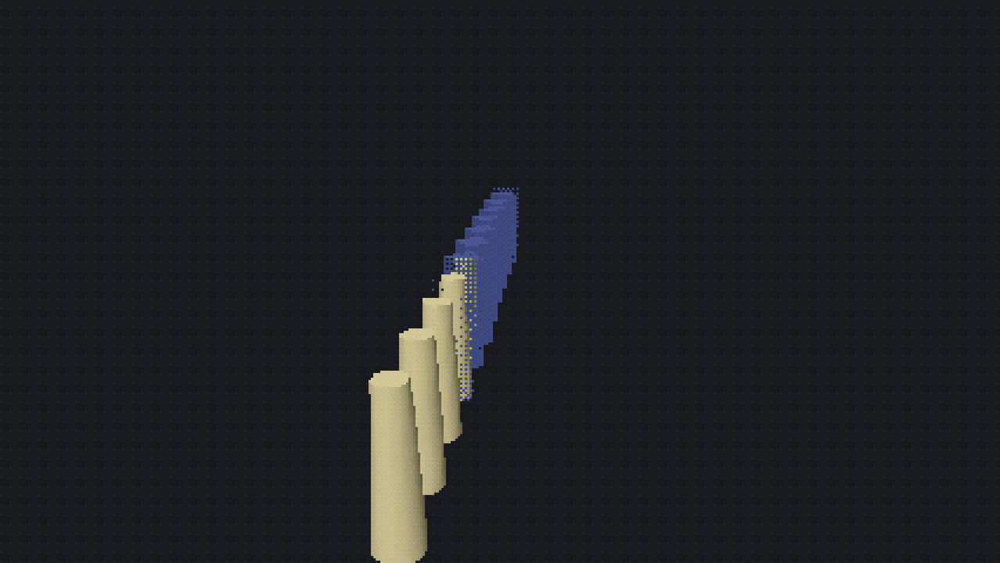
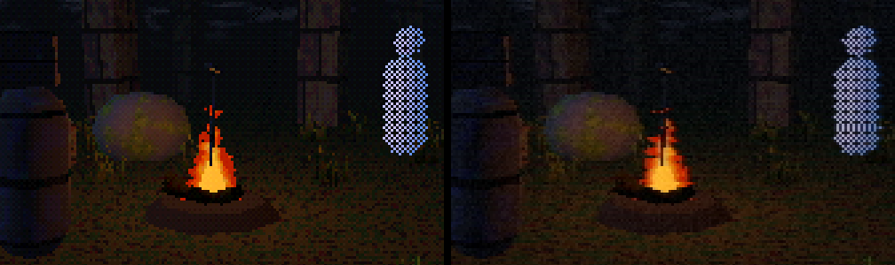

# PS1 Godot

A small, drop-in toolkit for making **PlayStation 1-style 3D games in Godot 4** (tested on 4.7).

It reproduces the hardware quirks that make PS1 games look the way they do, without getting in the way of modern gameplay code:

| Effect | How |
|---|---|
| Vertex jitter (wobbly geometry) | Vertices snapped to a low-res screen grid in clip space |
| Affine texture mapping (warping textures) | Perspective correction undone in the shader |
| Per-vertex (Gouraud) lighting | `vertex_lighting` render mode |
| Crunchy textures | Nearest filtering, no mipmaps |
| Low resolution | 320x240 base viewport, integer-ish nearest upscale (widens on 16:9) |
| 15-bit color + dithering | Full-screen post-process with a 4x4 Bayer matrix |
| Fog / short draw distance | `Environment` depth fog + `PS1.draw_distance()` / `PS1LOD` with dithered fades |
| Screen-door transparency | `dither_alpha` material (no alpha blending, like the PS1) |
| Alpha-tested textures | `cutout` material (fences, grass, foliage) |
| 4/8-bit CLUT textures | `PS1Palette.quantize(tex, 16)` (k-means palette) |
| Pre-lit geometry (Silent Hill / RE style) | `PS1Bake`: lights + raycast shadows baked into vertex colors, cached to disk |
| Fixed screen palette | `PS1.set_screen_palette()` / `PS1.palette_from_screen(24)` |
| Level painter (RPG Maker style) | `PS1GridLevel` + "PS1 Pieces" panel: paint pieces on a grid in the 3D viewport, auto-edge walls, layers, undo, "Test here"; starter piece kit included |
| Sprites (trees, fire, particles) | `PS1Sprite`: billboards with jitter, alpha test and sprite-sheet animation |
| Composite video (TV) look | `PS1.set_composite(1.0)`: chroma bleed, line jitter, grain, vignette |
| Sky dome and water | `PS1Sky` (gradient into fog, clouds, stars, moon), `PS1Water` (waves, scrolling affine layers, dithered transparency) |


## Install

1. Copy `addons/ps1_godot/` into your project.
2. *Project > Project Settings > Plugins*: enable **PS1 Godot**. This registers the `PS1` autoload and the `ps1_*` shader globals.
3. Restart the editor (shader globals are only picked up on startup).
4. Recommended project settings (see this repo's `project.godot`):
   - `display/window/size/viewport_width/height = 320 x 240`, `stretch/mode = viewport`, `stretch/aspect = expand`
   - `rendering/textures/canvas_textures/default_texture_filter = Nearest`
   - `rendering/anti_aliasing/quality/msaa_3d = Disabled`

## Usage

**Materials from code**
```gdscript
var mat := PS1.material(my_texture, Color.WHITE, Vector2(4, 4))   # texture, tint, uv scale
var glow := PS1.material(tex, Color.WHITE, Vector2.ONE, Color.ORANGE, 2.0)  # + emission
var cape := PS1.material(tex, Color.WHITE, Vector2.ONE, Color.BLACK, 0.0, true)  # double-sided
```

**All options** (`PS1.make`)
```gdscript
var fence := PS1.make(fence_tex, {mode = "cutout", alpha_cut = 0.5})
var ghost := PS1.make(tex, {mode = "dither_alpha", color = Color(1, 1, 1, 0.4)})
var crunchy := PS1.make(tex, {texture_color_levels = 8})   # per-channel levels, cheap
```
Modes: `opaque` (default), `double_sided`, `cutout`, `dither_alpha`, `unlit`, `unlit_cutout`.
Other keys: `color`, `uv_scale`, `emission`, `emission_energy`, `alpha_cut`, `texture_color_levels`, `vertex_color`.

**Texture palettes** (like PS1 4-bit / 8-bit CLUT textures)
```gdscript
var tex16 := PS1Palette.quantize(my_texture, 16)          # k-means, once at load
var tex16d := PS1Palette.quantize(my_texture, 16, 0.5)    # + ordered dithering
```
Or in the editor: select textures in the FileSystem dock, open `addons/ps1_godot/tools/quantize_selected.gd`
and run it (*File > Run*). It writes `<name>_16c.png` next to each texture.


**Draw distance and LOD**
```gdscript
PS1.draw_distance($Trees, 20.0, 4.0)   # dithered fade between 16 and 20 m, then culled
```
`PS1LOD` node: its children are the levels (child 0 up close). `distances = [15]` switches to child 1
at 15 m, `draw_distance = 27` hides the last level, `fade = 3` makes every switch a dithered
cross-fade (`0` = hard pop, very PS1). In and out fades use complementary dither patterns, so the
two levels never leave holes or overlap.



**Baked vertex lighting** (pre-lit geometry, the Silent Hill / Resident Evil way)
```gdscript
await PS1Bake.bake_scene($Level, Color(0.2, 0.2, 0.25))   # ambient; shadows on by default
```
Bakes every visible light (directional, omni, spot) plus raycast shadows into vertex colors and
switches the materials to the `unlit` variant (`texture * vertex color * 2`, the PS1's 2x
modulation). Static levels get lighting and shadows for free at runtime; keep characters and
moving props on lit materials. Lighting is per vertex, so subdivide big surfaces.
`mesh.set_meta("ps1_no_bake", true)` skips a mesh, `"ps1_no_cast"` bakes it without casting
shadows (small props sitting on a light), `light.set_meta("ps1_no_shadow", true)` disables a
light's shadows. Cutout meshes (grass, fences) never cast baked shadows.

**One-click bake (recommended workflow)**
1. Put the static geometry of your level under a **`PS1BakedLevel`** node (set its `ambient`).
2. Click **PS1 Bake** in the 3D editor toolbar. The scene is saved and baked in a background
   headless process (physics is needed for the shadow rays), and the result goes to
   `res://ps1_bake_cache/`.
3. At runtime the node loads the cache instantly; if the level changed since the bake, it rebakes
   on load and saves again (when running from the editor).

Same thing from a terminal / CI: `godot --headless --path . res://my_level.tscn -- --ps1-bake-only --ps1-bake-force`

**Bake once, load instantly (from code)**
```gdscript
await PS1Bake.bake_scene_cached($Level, Color(0.2, 0.2, 0.25))   # -> res://ps1_bake_cache/<scene>_<node>.res
```
The first run bakes and saves; later runs load the result (demo: ~400 ms -> ~80 ms). The cache is
rebuilt automatically when meshes, transforms or lights change. Run the scene once from the editor
and ship the cache file with your game (`res://` is read-only in exported builds).


*Left: realtime vertex lighting. Right: baked (light + shadows in vertex colors, unlit materials).*

**Sprites** (`PS1Sprite`: pivot at the bottom center)
```gdscript
var pine := PS1Sprite.new()              # lit, turns around Y only: trees, sprite characters
pine.texture = PS1Textures.pine()
pine.size = Vector2(3, 6)

var fire := PS1Sprite.new()              # unlit, always faces the camera: fire, effects
fire.texture = PS1Textures.flame_sheet() # 4 frames side by side
fire.hframes = 4
fire.fps = 10.0
fire.lit = false
```
Materials `billboard` / `billboard_unlit` also work on any quad, including `GPUParticles3D`
draw passes. Frame selection is a per-instance uniform (`ps1_uv_rect`), so many sprites share
one material.


**Composite video filter**
```gdscript
PS1.set_composite(1.0)   # 0 = off. Chroma bleeds over ~3 pixels, luma stays sharp, rare line
                         # jitter, grain and vignette. Applied after dithering, so it "melts"
                         # the dither pattern like a real TV did.
```

*Left: clean output. Right: composite filter.*

**Screen palette** (the whole frame limited to N colors, max 256)
```gdscript
PS1.set_screen_palette(PackedColorArray([Color("#0b0c10"), Color("#3a2f2a"), ...]))
await PS1.palette_from_screen(24)   # k-means palette of the current frame, applied at once
PS1.clear_screen_palette()
```
`palette_from_screen` counts each distinct color once, so small but important areas (a fire, a
moon) keep their colors. Uses the global dithering setting.


**Sky and water**
```gdscript
var sky := PS1Sky.new()                  # follows the camera; horizon = fog color by default
sky.clouds = PS1Sky.cloud_texture()
sky.moon_direction = $Moon.global_basis.z
add_child(sky)

var pond := PS1Water.new()               # subdivided plane with vertex waves
pond.size = Vector2(6, 4)
pond.color = Color(0.35, 0.5, 0.62, 0.7) # alpha = screen-door density
add_child(pond)
```

**Shader globals at runtime**: use `PS1.set_global(name, value)` / `PS1.get_global(name)`.
(`RenderingServer.global_shader_parameter_get()` only works inside the editor.)

**Hit flash** (per-instance, no material duplication)
```gdscript
PS1.flash($Enemy)                         # white flash, 0.12 s
PS1.flash($Player, Color.RED, 0.2)
```

**Convert imported models (Blender .glb, .blend...)**
```gdscript
PS1Convert.apply($Knight)   # keeps albedo color/texture, emission and cull mode
```
Or do it at import time: select the model, in the *Import* dock set **Import Script** to
`res://addons/ps1_godot/import/ps1_post_import.gd` and click *Reimport*.

**Shaders** (use directly on a `ShaderMaterial`):
- `shaders/ps1_lit.gdshader` / `ps1_lit_double_sided.gdshader` - parameters `albedo_tex`, `albedo_color`, `uv_scale`, `emission_color`, `emission_energy`
- `shaders/ps1_post.gdshader` - applied automatically by the `PS1` autoload

**Global settings** (*Project Settings > Shader Globals*, or at runtime with `RenderingServer.global_shader_parameter_set`):

| Global | Default | Meaning |
|---|---|---|
| `ps1_snap_resolution` | `(320, 240)` | Grid vertices snap to. Lower = more wobble |
| `ps1_jitter_enabled` | `1.0` | Vertex snapping on/off |
| `ps1_affine_enabled` | `1.0` | Affine texture warping on/off |
| `ps1_dither_enabled` | `1.0` | Dithering on/off |
| `ps1_color_levels` | `32.0` | Levels per color channel (32 = 15-bit color) |

**Debug keys** (debug builds only; set `PS1.debug_keys = false` to disable):
F1 jitter, F2 affine, F3 dither, F4 resolution (240p/360p/480p), F5 color depth, F9 composite.

## Level painter

Build levels by painting pieces on a grid, like RPG Maker, inside the normal Godot editor.


1. Add a **`PS1GridLevel`** node to your scene (it is a `PS1BakedLevel`, so the lighting of
   everything you paint is pre-baked) and select it: the **PS1 Pieces** panel opens at the bottom.
2. Pick a piece and paint in the 3D viewport:

| Input | Action |
|---|---|
| LMB / drag | paint (a drag paints every cell it crosses) |
| Shift+LMB | erase pieces of the same kind (floor, wall, light...) |
| Ctrl+Shift+LMB | erase everything in the cell |
| R / Shift+R | rotate the piece |
| PgUp / PgDn | change layer (floor height, `layer_height`) |
| Esc | stop painting (back to normal selection) |
| RMB / MMB | camera, as usual |

* **Walls, doors and wall torches snap to the cell edge nearest the mouse**: no rotating needed.
* **Auto walls**: set `auto_wall` (and optionally `auto_ceiling`) on the `PS1GridLevel`, then just
  paint floors: every floor -> empty edge gets a wall, erasing floor removes the walls left inside
  (and the torches hanging on them). Doors/arches you placed by hand are never touched. From code:
  `level.update_auto(cells)` / `level.rebuild_auto()`.
* One undo step per stroke. **Hide ceilings** shows inside rooms while you edit (ceilings are never
  saved hidden). **Test here** saves and runs the scene with the player at the hovered cell: call
  `PS1.take_test_spawn(scene_file_path)` where your game spawns the player.
* **Pieces are plain scenes** in the palette folders (`palette_dirs`; sub-folders = categories;
  thumbnails are rendered automatically, also for scenes made from code). The root's metadata says
  where a piece sits: `ps1_slot` (`"floor"`, `"wall"`, `"ceiling"`, `"light"`, `"prop"`...: one piece
  per slot per cell, painting replaces) and `ps1_edge = true` for edge pieces. Gameplay pieces work
  the same way: an `@tool` script that shows a preview in the editor and spawns the real thing
  (enemy, checkpoint, door) at runtime.
* A **starter kit** ships in `addons/ps1_godot/starter_pieces/` (floor, wall, door, pillar,
  ceiling, stairs, iron fence, block, coffin, wall torch, brazier; cell 2 m, walls 4 m). Rebuild or
  use it as a template: `addons/ps1_godot/tools/make_starter_pieces.gd`.
* Levels can be painted **from code** too (procedural layouts, blocking out from a sketch):

```gdscript
var lvl := $Level as PS1GridLevel
lvl.place(load("res://pieces/wall.tscn"), Vector3i(3, 0, -2), 1)    # cell, quarter turns
lvl.erase(Vector3i(3, 0, -2), "wall:1")
lvl.paint_ascii(PackedStringArray(["#..#", "...."]), {"#": [pillar], ".": [floor]})
```


*`demo/grid_level_demo.tscn` running: painted with the starter kit, lighting baked.*

## Tips for authentic results

- **Subdivide large surfaces.** Lighting is per-vertex, so a big floor quad won't catch a torch's light, and affine warping gets extreme on big polygons. PS1 games tessellated floors and walls for exactly this reason.
- **Small textures:** 64x64 or 128x128, ideally hand-painted with a limited palette.
- **Keep characters around 500-2000 triangles** and model at real scale (1 Blender unit = 1 m, apply scale before exporting).
- **Use fog** to hide the far plane; it's half of the atmosphere.

## Demo

Open this folder in Godot and press F5. `TAB` toggles a free camera (WASD, Q/E, mouse),
**F6** switches realtime / baked lighting, **F7** toggles 16-color texture palettes,
**F8** cycles screen palettes taken from the current frame (24 / 12 colors), **F9** toggles the
composite video filter.

## Tests

```
godot --headless --path . res://tests/test_toolkit.tscn     # bake, palette, LOD, converter
godot --path . res://tests/lod_visual.tscn                   # visual LOD check
godot -e --path . -- --ps1-painter-selftest=res://demo/grid_level_demo.tscn   # painter in the real editor
godot --headless --path . res://tests/baked_level_test.tscn -- --ps1-bake-only --ps1-bake-force
```

## Roadmap

- [x] Core look: jitter, affine, vertex lighting, low-res, dithering
- [x] Material converter + import script
- [x] Per-instance hit flash
- [x] Texture palettes (k-means CLUT) + per-channel levels
- [x] Cutout (alpha-test) and screen-door (dithered) transparency
- [x] Draw distance + LOD with dithered cross-fades
- [x] Baked vertex lighting with raycast shadows
- [x] Bake cache (bake once, load instantly)
- [x] Screen palette (fixed or taken from the current frame)
- [x] Sky dome and water
- [x] One-click bake from the editor toolbar (`PS1BakedLevel`)
- [x] Composite video filter
- [x] Sprites / billboards with sprite-sheet animation
- [ ] Native-resolution CRT pass (scanlines, mask, curvature)
- [ ] Vertex-color painting helpers (fake AO, gradients)
- [x] Level painter (`PS1GridLevel`) with starter pieces
- [x] Auto walls / ceilings: paint floors, walls follow
- [ ] Asset Library package

## License

MIT - see [LICENSE](LICENSE). Use it in anything, commercial or not.
