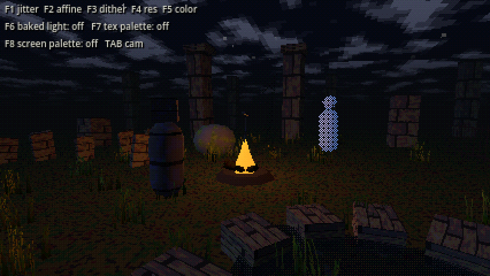
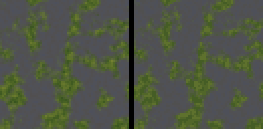
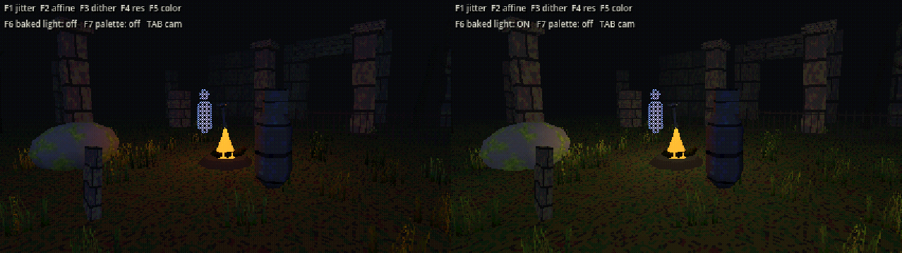
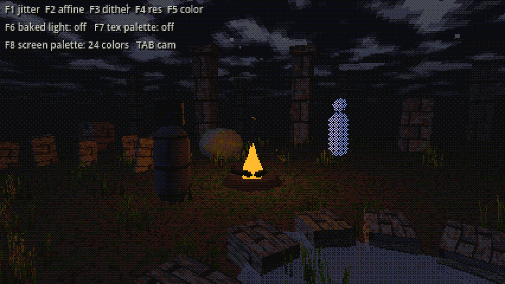

# PS1 Godot

A small, drop-in toolkit for making **PlayStation 1-style 3D games in Godot 4** (tested on 4.7).

It reproduces the hardware quirks that make PS1 games look the way they do, without getting in the way of modern gameplay code:

| Effect | How |
|---|---|
| Vertex jitter (wobbly geometry) | Vertices snapped to a low-res screen grid in clip space |
| Affine texture mapping (warping textures) | Perspective correction undone in the shader |
| Per-vertex (Gouraud) lighting | `vertex_lighting` render mode |
| Crunchy textures | Nearest filtering, no mipmaps |
| Low resolution | 320x240 base viewport, integer-ish nearest upscale (widens on 16:9) |
| 15-bit color + dithering | Full-screen post-process with a 4x4 Bayer matrix |
| Fog / short draw distance | `Environment` depth fog + `PS1.draw_distance()` / `PS1LOD` with dithered fades |
| Screen-door transparency | `dither_alpha` material (no alpha blending, like the PS1) |
| Alpha-tested textures | `cutout` material (fences, grass, foliage) |
| 4/8-bit CLUT textures | `PS1Palette.quantize(tex, 16)` (k-means palette) |
| Pre-lit geometry (Silent Hill / RE style) | `PS1Bake`: lights + raycast shadows baked into vertex colors, cached to disk |
| Fixed screen palette | `PS1.set_screen_palette()` / `PS1.palette_from_screen(24)` |
| Sky dome and water | `PS1Sky` (gradient into fog, clouds, stars, moon), `PS1Water` (waves, scrolling affine layers, dithered transparency) |



## Install

1. Copy `addons/ps1_godot/` into your project.
2. *Project > Project Settings > Plugins*: enable **PS1 Godot**. This registers the `PS1` autoload and the `ps1_*` shader globals.
3. Restart the editor (shader globals are only picked up on startup).
4. Recommended project settings (see this repo's `project.godot`):
   - `display/window/size/viewport_width/height = 320 x 240`, `stretch/mode = viewport`, `stretch/aspect = expand`
   - `rendering/textures/canvas_textures/default_texture_filter = Nearest`
   - `rendering/anti_aliasing/quality/msaa_3d = Disabled`

## Usage

**Materials from code**
```gdscript
var mat := PS1.material(my_texture, Color.WHITE, Vector2(4, 4))   # texture, tint, uv scale
var glow := PS1.material(tex, Color.WHITE, Vector2.ONE, Color.ORANGE, 2.0)  # + emission
var cape := PS1.material(tex, Color.WHITE, Vector2.ONE, Color.BLACK, 0.0, true)  # double-sided
```

**All options** (`PS1.make`)
```gdscript
var fence := PS1.make(fence_tex, {mode = "cutout", alpha_cut = 0.5})
var ghost := PS1.make(tex, {mode = "dither_alpha", color = Color(1, 1, 1, 0.4)})
var crunchy := PS1.make(tex, {texture_color_levels = 8})   # per-channel levels, cheap
```
Modes: `opaque` (default), `double_sided`, `cutout`, `dither_alpha`, `unlit`, `unlit_cutout`.
Other keys: `color`, `uv_scale`, `emission`, `emission_energy`, `alpha_cut`, `texture_color_levels`, `vertex_color`.

**Texture palettes** (like PS1 4-bit / 8-bit CLUT textures)
```gdscript
var tex16 := PS1Palette.quantize(my_texture, 16)          # k-means, once at load
var tex16d := PS1Palette.quantize(my_texture, 16, 0.5)    # + ordered dithering
```
Or in the editor: select textures in the FileSystem dock, open `addons/ps1_godot/tools/quantize_selected.gd`
and run it (*File > Run*). It writes `<name>_16c.png` next to each texture.



**Draw distance and LOD**
```gdscript
PS1.draw_distance($Trees, 20.0, 4.0)   # dithered fade between 16 and 20 m, then culled
```
`PS1LOD` node: its children are the levels (child 0 up close). `distances = [15]` switches to child 1
at 15 m, `draw_distance = 27` hides the last level, `fade = 3` makes every switch a dithered
cross-fade (`0` = hard pop, very PS1). In and out fades use complementary dither patterns, so the
two levels never leave holes or overlap.


**Baked vertex lighting** (pre-lit geometry, the Silent Hill / Resident Evil way)
```gdscript
await PS1Bake.bake_scene($Level, Color(0.2, 0.2, 0.25))   # ambient; shadows on by default
```
Bakes every visible light (directional, omni, spot) plus raycast shadows into vertex colors and
switches the materials to the `unlit` variant (`texture * vertex color * 2`, the PS1's 2x
modulation). Static levels get lighting and shadows for free at runtime; keep characters and
moving props on lit materials. Lighting is per vertex, so subdivide big surfaces.
`mesh.set_meta("ps1_no_bake", true)` skips a mesh, `"ps1_no_cast"` bakes it without casting
shadows (small props sitting on a light), `light.set_meta("ps1_no_shadow", true)` disables a
light's shadows. Cutout meshes (grass, fences) never cast baked shadows.

**Bake once, load instantly**
```gdscript
await PS1Bake.bake_scene_cached($Level, Color(0.2, 0.2, 0.25))   # -> res://ps1_bake_cache/<scene>_<node>.res
```
The first run bakes and saves; later runs load the result (demo: ~400 ms -> ~80 ms). The cache is
rebuilt automatically when meshes, transforms or lights change. Run the scene once from the editor
and ship the cache file with your game (`res://` is read-only in exported builds).


*Left: realtime vertex lighting. Right: baked (light + shadows in vertex colors, unlit materials).*

**Screen palette** (the whole frame limited to N colors, max 256)
```gdscript
PS1.set_screen_palette(PackedColorArray([Color("#0b0c10"), Color("#3a2f2a"), ...]))
await PS1.palette_from_screen(24)   # k-means palette of the current frame, applied at once
PS1.clear_screen_palette()
```
`palette_from_screen` counts each distinct color once, so small but important areas (a fire, a
moon) keep their colors. Uses the global dithering setting.



**Sky and water**
```gdscript
var sky := PS1Sky.new()                  # follows the camera; horizon = fog color by default
sky.clouds = PS1Sky.cloud_texture()
sky.moon_direction = $Moon.global_basis.z
add_child(sky)

var pond := PS1Water.new()               # subdivided plane with vertex waves
pond.size = Vector2(6, 4)
pond.color = Color(0.35, 0.5, 0.62, 0.7) # alpha = screen-door density
add_child(pond)
```

**Shader globals at runtime**: use `PS1.set_global(name, value)` / `PS1.get_global(name)`.
(`RenderingServer.global_shader_parameter_get()` only works inside the editor.)

**Hit flash** (per-instance, no material duplication)
```gdscript
PS1.flash($Enemy)                         # white flash, 0.12 s
PS1.flash($Player, Color.RED, 0.2)
```

**Convert imported models (Blender .glb, .blend...)**
```gdscript
PS1Convert.apply($Knight)   # keeps albedo color/texture, emission and cull mode
```
Or do it at import time: select the model, in the *Import* dock set **Import Script** to
`res://addons/ps1_godot/import/ps1_post_import.gd` and click *Reimport*.

**Shaders** (use directly on a `ShaderMaterial`):
- `shaders/ps1_lit.gdshader` / `ps1_lit_double_sided.gdshader` - parameters `albedo_tex`, `albedo_color`, `uv_scale`, `emission_color`, `emission_energy`
- `shaders/ps1_post.gdshader` - applied automatically by the `PS1` autoload

**Global settings** (*Project Settings > Shader Globals*, or at runtime with `RenderingServer.global_shader_parameter_set`):

| Global | Default | Meaning |
|---|---|---|
| `ps1_snap_resolution` | `(320, 240)` | Grid vertices snap to. Lower = more wobble |
| `ps1_jitter_enabled` | `1.0` | Vertex snapping on/off |
| `ps1_affine_enabled` | `1.0` | Affine texture warping on/off |
| `ps1_dither_enabled` | `1.0` | Dithering on/off |
| `ps1_color_levels` | `32.0` | Levels per color channel (32 = 15-bit color) |

**Debug keys** (debug builds only; set `PS1.debug_keys = false` to disable):
F1 jitter, F2 affine, F3 dither, F4 resolution (240p/360p/480p), F5 color depth.

## Tips for authentic results

- **Subdivide large surfaces.** Lighting is per-vertex, so a big floor quad won't catch a torch's light, and affine warping gets extreme on big polygons. PS1 games tessellated floors and walls for exactly this reason.
- **Small textures:** 64x64 or 128x128, ideally hand-painted with a limited palette.
- **Keep characters around 500-2000 triangles** and model at real scale (1 Blender unit = 1 m, apply scale before exporting).
- **Use fog** to hide the far plane; it's half of the atmosphere.

## Demo

Open this folder in Godot and press F5. `TAB` toggles a free camera (WASD, Q/E, mouse),
**F6** switches realtime / baked lighting, **F7** toggles 16-color texture palettes,
**F8** cycles screen palettes taken from the current frame (24 / 12 colors).

## Tests

```
godot --headless --path . res://tests/test_toolkit.tscn     # bake, palette, LOD, converter
godot --path . res://tests/lod_visual.tscn                   # visual LOD check
```

## Roadmap

- [x] Core look: jitter, affine, vertex lighting, low-res, dithering
- [x] Material converter + import script
- [x] Per-instance hit flash
- [x] Texture palettes (k-means CLUT) + per-channel levels
- [x] Cutout (alpha-test) and screen-door (dithered) transparency
- [x] Draw distance + LOD with dithered cross-fades
- [x] Baked vertex lighting with raycast shadows
- [x] Bake cache (bake once, load instantly)
- [x] Screen palette (fixed or taken from the current frame)
- [x] Sky dome and water
- [ ] One-click bake from the editor toolbar
- [ ] CRT / composite video filter (optional)
- [ ] Sprite billboards (PS1 trees, particles) with jitter

## License

MIT - see [LICENSE](LICENSE). Use it in anything, commercial or not.
